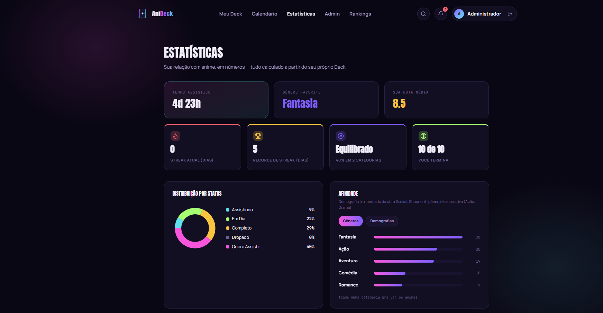
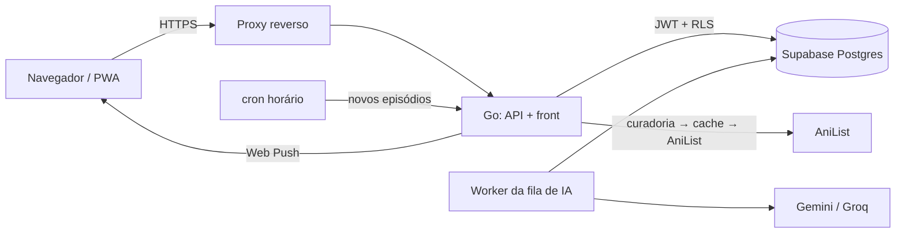

# AniDeck

Organizador de animes com curadoria própria: a sua lista, o progresso por episódio, a agenda de
lançamentos no seu fuso e uma leitura do seu gosto. Em português, com sinopses e tags curadas.

**No ar em beta fechado:** [anideck.joaomendes.dev.br](https://anideck.joaomendes.dev.br). Catálogo,
busca, detalhes e rankings são abertos; o deck pessoal pede convite.



## O que ele faz

| Área | O que entrega |
|---|---|
| **Início** | O próximo episódio a assistir com botão de marcar, a semana do deck, trilhas da curadoria e recomendações pelo seu gosto |
| **Meu Deck** | A coleção por status (assistindo, em dia, completo, quero assistir, dropado), com nota, favoritos e anotação |
| **Progresso por episódio** | Marcação episódio a episódio, com trava para o que ainda não foi ao ar |
| **Agenda** | Contagem regressiva dos próximos episódios, no horário de quem está olhando |
| **Meu Gosto** | Afinidade por gênero, distribuição por status, streak e uma frase-resumo, com um card para compartilhar |
| **Guilda** | Nível, rank de F a SS, especialista por gênero e insígnias, ganhos com atividade real (marcar em lote não conta) |
| **Notificações** | Aviso no app e push no celular quando sai episódio de um anime do deck |
| **Curadoria** | Painel administrativo para sinopse, tags, episódios e links; fila de IA que propõe e o curador aprova |

## Stack

| Camada | Tecnologia |
|---|---|
| Backend | Go 1.26, `chi`, JWT do Supabase Auth validado por JWKS |
| Banco | PostgreSQL no Supabase, acessado por HTTP (`postgrest-go`), com RLS em todas as tabelas |
| Frontend | React 19, TypeScript, Vite e Tailwind 4, servido pelo próprio binário Go |
| Fontes externas | AniList (GraphQL), Gemini e Groq (curadoria assistida), Web Push |
| Infraestrutura | Docker numa VPS, atrás de um proxy reverso com HTTPS; CI no GitHub Actions |

## Arquitetura



- **A curadoria vem antes da AniList.** Toda leitura passa por curadoria → cache → AniList: se a
  API externa cai, o app continua no ar com o que está gravado.
- **Identidade vem do token.** O `user_id` sai do JWT validado; o banco aplica RLS com o mesmo
  token, então uma falha de autorização no código ainda esbarra no banco.
- **O worker é um processo separado,** na mesma imagem do app, para que um deploy não corte uma
  pesquisa de IA no meio.

## Rodando localmente

Pré-requisitos: Go 1.26 e Node 24.

```bash
cp .env.example .env              # preencha com as chaves do seu projeto Supabase
cp client/.example client/.env    # as VITE_* são lidas no build
MOCK_ANILIST=true go run ./cmd/web   # terminal 1, na raiz
cd client && npm ci && npm run dev   # terminal 2
```

O `MOCK_ANILIST` troca só a AniList por um cliente falso; banco e IA continuam os reais.

## Testes

```bash
go vet ./... && go test ./...                  # backend
cd client && npm run lint && npm test          # frontend (ESLint e Vitest)
```

O CI (`.github/workflows/ci.yml`) roda os mesmos passos e o build a cada push na `staging`. A
`main` publica e só recebe o que passou por ele.

## Estrutura

| Pasta | O que guarda |
|---|---|
| `cmd/web/` | Servidor HTTP: rotas, arquivos estáticos e boot |
| `cmd/worker/` | Worker da fila de curadoria por IA |
| `internal/handlers/` | Regras de cada rota e seus testes |
| `internal/anilist/` | Cliente GraphQL da AniList, com cache e limite de requisições |
| `internal/ia/` | Chamadas ao Gemini e ao Groq, com modelos de reserva |
| `client/` | O app React |
| `sql/` | Schema versionado, aplicado à mão em ordem (ver `sql/README.md`) |
| `docs/` | Roadmap, decisões, armadilhas conhecidas e visões de produto |

## Documentação

- [`docs/ROADMAP.md`](docs/ROADMAP.md): fases e backlog
- [`docs/DECISIONS.md`](docs/DECISIONS.md): decisões de arquitetura, com o porquê e o custo aceito
- [`docs/PITFALLS.md`](docs/PITFALLS.md): bugs silenciosos que já aconteceram e como evitá-los
- [`docs/PAGES.md`](docs/PAGES.md): estado de cada tela
- [`AGENTS.md`](AGENTS.md): regras do repositório e fluxo de trabalho

## Autor

João Victor Mendes · [joaomendes.dev.br](https://joaomendes.dev.br) ·
[GitHub](https://github.com/JoaoMendes1)
